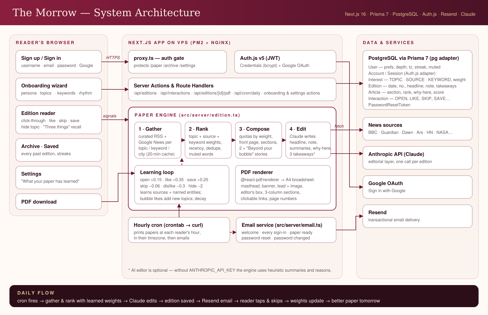

# The Morrow — *Your morning, considered.*

A personal morning newspaper. The Morrow learns what each reader cares about, gathers the stories that matter to them from across the web every day, and sets them into one edition — read it on the web, click through to any original, skip what doesn't land, or download it as a newspaper-style PDF.

Built for the **NaSCon '26** hackathon problem statement "Build a personal morning paper".



## What's inside

| Requirement | How The Morrow does it |
|---|---|
| **Onboarding** | Four-step glass wizard: name + persona → tap topics (tap twice to ♥ *love*) → specific people/things to follow + city → reading depth, delivery hour, email. Timezone and news region auto-detected. |
| **PDF** | `@react-pdf/renderer` builds an A4 broadsheet: masthead, dateline, banner headline, lead story with image, "From the Editor" and "Three Things to Remember" boxes, column grid per section, clickable source links, page numbers. |
| **Webpage** | Masthead, editor's note, front page, sticky section nav, reading-progress bar, per-story *why it's here*, like / dislike / save / skip / mute-topic, archive of every past edition, saved clippings. |
| **Learning** | Every action adjusts weighted interests (topics, sources, named entities). Likes on "Beyond your bubble" stories add new topics. Unused signals decay so tastes can change. Settings shows exactly what the paper has learned, with ± and remove controls. |
| **Room to explore** | Daily serendipity section, "Three things to remember" recall card (so readers *can* name three things they learned), reading streaks, AI editor (Claude) writing the headline, note, summaries and reasons. |

### Accounts & email
- Sign up with **username, email, password**, or **Sign in with Google**; sign in with email *or* username.
- Live username availability, password strength meter, show/hide password, forgot / reset password.
- **Resend** emails: welcome on every sign-up, alert on every sign-in (method, time, IP, device), daily "your paper is ready", password reset and password-changed notices. Without `RESEND_API_KEY`, emails are logged to the console.

## Stack
Next.js 16 (App Router, `src/`, TypeScript, Cache Components **off**) · shadcn/ui-style components on Tailwind v4 + custom CSS frosted glass · Prisma 7 + PostgreSQL · Auth.js v5 · Resend · rss-parser · @react-pdf/renderer · optional Anthropic API.

## Run locally
```bash
cp .env.example .env          # fill in DATABASE_URL, AUTH_SECRET at minimum
npm install                   # also generates the Prisma client
npx prisma migrate deploy
npm run dev
```
Set `MORROW_FIXTURES=1` to use clearly-labelled sample stories when you're offline.

## Deploy to a VPS (Ubuntu)
```bash
sudo bash deploy/setup-postgres.sh 'a-strong-db-password'   # prints DATABASE_URL
cp .env.example .env && nano .env
bash deploy/deploy.sh                                        # install, migrate, build, start with PM2 on :3010
```
Then add `deploy/nginx.conf` (+ `certbot --nginx`) and the hourly line in `deploy/crontab.txt`.

**Google OAuth redirect URI:** `https://YOUR_DOMAIN/api/auth/callback/google`

## Project map
```
src/
  app/(auth)/        sign in, sign up, forgot/reset password, server actions
  app/(app)/         paper, archive, saved, settings (signed-in shell)
  app/onboarding/    setup wizard
  app/api/           editions, interactions, PDF, cron, username check, Auth.js
  server/            edition engine, sources, learning, AI editor, PDF, email
  components/        UI kit (shadcn-style), reader, auth, onboarding, settings
prisma/              schema + migrations
deploy/              deploy script, PM2, Nginx, crontab, Postgres setup
docs/                architecture diagram
```
